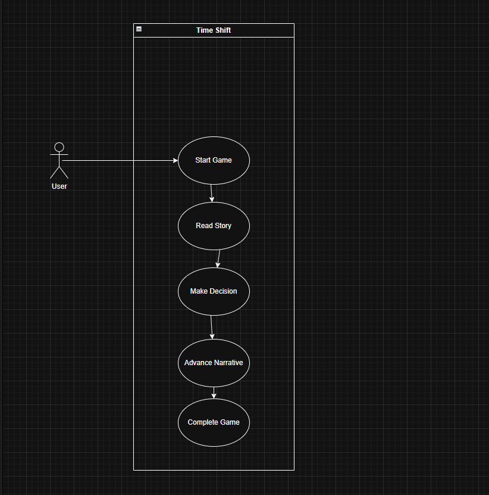
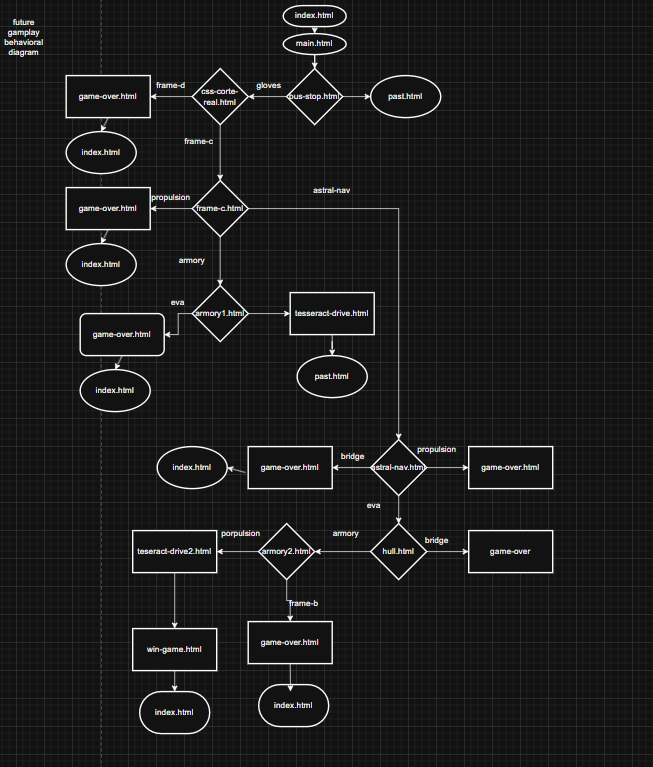
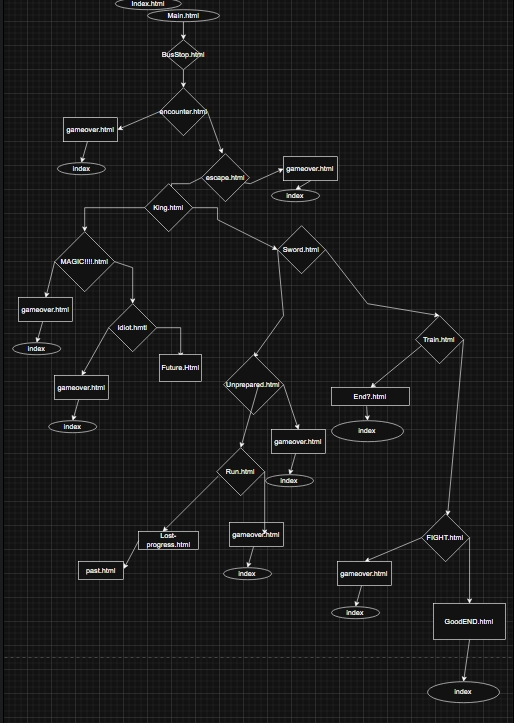
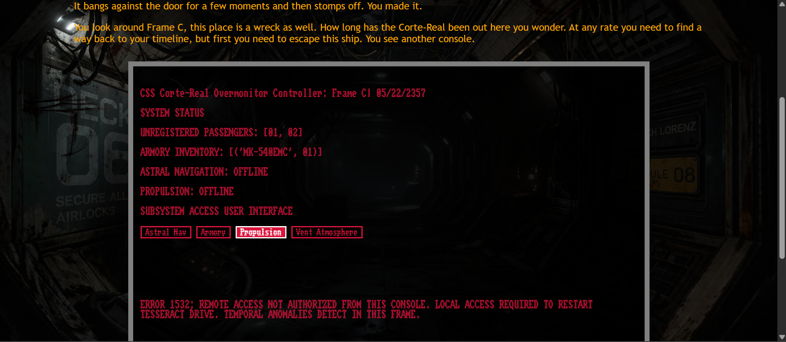
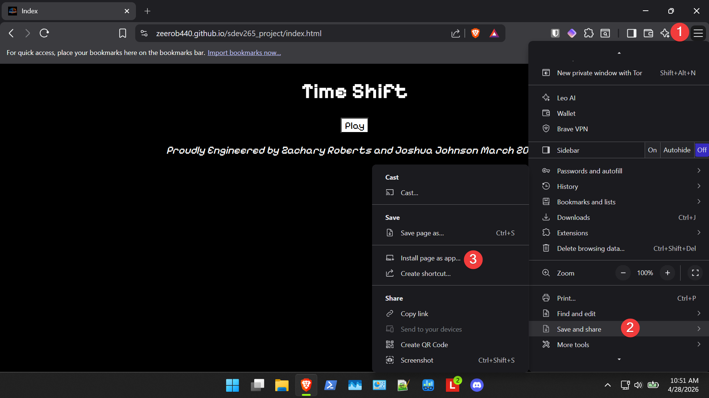
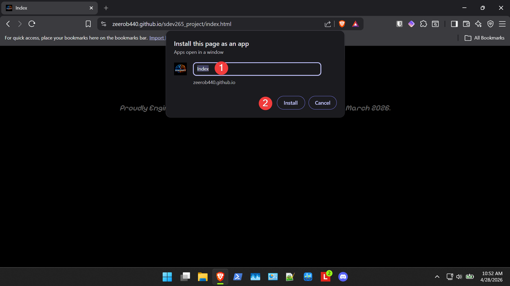

# INTRODUCTION

Time Shift is an interactive choose your own adventure website developed by Joshua Johnson,
and Zachary Roberts. In Time Shift the user navigates webpages and is presented with choices similar to a text-adventure. The user selects their choices which may affect their outcome. The game is set in the present but the user is soon teleported through time as they progress through the game.

# STEP-BY-STEP

1. Using your favorite browser navigate to [https://zeerob440.github.io/sdev265_project/](https://zeerob440.github.io/sdev265_project/)
2. Each page of Time Shift contains story and decision buttons. Read the story and select the decision you wish to make.
3. All decisions have consequences.
4. Once in a timeline you cannot refresh or go back without getting a game over.
5. Some pages have interactive buttons that can give you clues, lore, or easter eggs.
6. The object of the game is to successfully return to your timeline.

# SUMMARY

Time Shift is intended to be a short diversion for users that work on computers daily. The given design paradigms ensure the development team can deliver a quality product to meet the declared specifications of Time Shift. The Behavior Diagrams will assist the development team with webpage development given the fairly complex selection pathways. The Use Case diagram depicts Time Shift's simplicity-by-design.

Time Shift is an interactive choose your own adventure website developed by Joshua Johnson,
and Zachary Roberts. In Time Shift the user navigates webpages and is presented with choices similar to a text-adventure. The user selects their choices which may affect their outcome. The game is set in the present but the user is soon teleported through time as they progress through the game.

# DESIGN DIAGRAMS

## Usecase Diagram

This use case diagram demonstrates the client side flat-file architecture Time Shift uses to create an elegant but immersive user experience.

## Future Behavior Diagram
This behavior diagram tracks system behavior based on user selections in the future timeline. There are multiple game over terminators which redirect to index.html, 2 time travel states between time lines and one win game terminator.

## Past Behavior Diagram

# DATA DESIGN
Time Shift is designed to be light-weight, therefore Time Shift uses client-side flat-file structures  stored with in HTML and in some cases JavaScript codebases. The text output drives the story, adds lore, and embeds easter eggs. This design was chosen for scalability and simplicity to help meet the demands of a short runway. This architecture is congruent from the fast, fun diversion that Time Shift is intended to provide to users.

# INTERFACE DESIGN
Time Shift is a text-based adventure and the UI reflects that game mechanic. Each HTML document provides story narrative, next the user is presented several decisions via buttons that determine in what manner the user wants to advance the narrative or solve a problem posed by the story. These buttons are placed in selection_suite classes. Some buttons serve a method to advance the story by allowing the user to interact with it, such as interacting with a terminal in-game.

An example of a UI driven narrative is below:

# TEST CASES
1. Ensure each page for at least 2 user choices per page if page does not terminate.
    - Test: each non-terminating page for at least 2 user selection options.
    - Action: click all available selections.
    - Expected: each selection should function as designed
    - 04 MAY 2026: Functions as designed

2. Ensure endgame behavior functions as designed.
    - Test: Each endgame condition
    - Action: navigate each endgame sequence.
    - Expected: All endgame conditions function as designed.
    - 04 MAY 2026: End game states function as designed.

3. Ensure back and refresh redirect to index.html after development is completed.
    - Test: attempt back and refresh on each page.
    - Action: attempt back and refresh on each page.
    - Expected: each page redirects to index.html on refresh or back.
    - 04 MAY 2026: no_go_back.js functions as designed.

4. Ensure Time Shift is optimized for all screen sizes.
    - Test: Time Shift renders correctly on all screen sizes
    - Action: test each page in dev tools, and mobile devices.
    - Expected: all pages render as expected.
    - 04 MAY 2026: Time Shift tested on Brave, Chrome, and Firefox on various screen sizes; Renders and functions as designed. 

# SUMMARY

Time Shift is intended to be a short diversion for users that work on computers daily. The given design paradigms ensure the development team can deliver a quality product to meet the declared specifications of Time Shift. The Behavior Diagrams will assist the development team with webpage development given the fairly complex selection pathways. The Use Case diagram depicts Time Shift's simplicity-by-design.

# INTRODUCTION
Time Shift is a text-based adventure, it allows a user to navigate a narrative through a website by presenting a decision and allowing the user to decide which action they want to take by clicking a link.

The DEVOPS_TOOLCHAIN.md serves as the overview of the project's development details across the software's life cycle, including processes, tools, and CI/CD. One of the standout DevOps processes used by the development team is to place planning documents directly into the project root. This maintains a sole source of truth for the project's lifecycle. This documentation will ensure that continuity of development and operations is within a common operating picture throughout the development team.

# PLANNING
All Project documentation is stored in the project root Main branch. All project documentation is written as Markdown files. The Markdown files are tracked by Git, therefore all documentation is version controlled and the sole sources of truth.

Collaboration is facilitated through a Discord server shared between the development team, there is a WBD, project schedule, and tracking & monitoring in PROJECT_PLAN.md in the project root of the main branch to ensure duplication of effort is minimized.

Issue tracking is regulated by strict commit comment conventions. The commit comment conventions are listed in COMMIT_COMMENT_BRANCHING_CODEX.md

# DEVELOPMENT
Time Shift is developed with the VS Code, version controlled with Git and GitHub Desktop and hosted on GitHub pages. This strategy ensures the code is version controlled for the entirety of the project's life cycle.

Commit comments follow a standard methodology to prevent vague commit comment that may be difficult to understand by the development team.

A strict branching strategy will be followed. The workflow will be:
1. main --> create feature branch
2. build feature
3. pull updates from main into work branch often (integral)
4. work is complete
5. feature branch externally stored on a USB drive, external HDD or SSD.
6. merge work branch into main during live team meetings.

Branch naming conventions are in COMMIT_COMMENT_BRANCHING_CODEX.md

# BUILD & TEST

Time Shift uses project structure and good naming conventions to build all codebase. This is a less complex approach which is advantageous for short development times. Testing and validation are facilitated by manual processes. Comment and branch naming conventions are documented in COMMIT_COMMENT_BRANCHING_CODEX.md. This assists with code validation before branches are merged, thereby ensuring quality code output.

Automated validation may be incorporated at a later date, if the current system proves to be inadequate. However, our current build & test methods supports CI and allows the development team to maintain alignment across branches, testing, and deployment which is congruent with DevOps processes.

# RELEASE
Time Shift is released continuously on a live GitHub Pages site, therefore release and deployment are concurrent and in accordance with a continuous deployment model.

Finished feature branches will be merged to main following defined branching methodologies outlined in the DEVELOPMENT heading in this document. Main is the production codebase, therefore it is the only branch deployed to a live GitHub Pages site.

Versioning will follow the methodologies described in COMMIT_COMMENT_BRANCHING_CODEX.md. The intent of the versioning method is to create human-legible, predictable versioning nomenclature.

# PACKAGE AND DEPLOY
Time Shift has a short runway and a small development team, therefore the DevOps toolchains employed are elegant. Time Shift's codebase consists of HTML/CSS/JavaScript files. Since Time Shift's Main branch is already deployed to a live GitHub Pages website package deployment is automated and deployed whenever a change is synched on Main.

This workflow simplifies the deployment process. It is scalable, repeatable and congruent with high-tempo CI/CD operations.

# OPERATE
Time Shift is essentially a website with game-like attributes. Therefore, GitHub Pages was selected to host the website due to its stability and field expedience. Using GitHub Pages to host the site removes the need for the development team to manage infrastructure.
The website is manually monitored and validated after it is deployed. This includes monitoring expected navigation, style rendering, and script outputs.

When an issue occurs and if it is a small bug the patch is developed in situ from Main. Otherwise if the bug is large a feature branch is built to patch it, then merged to Main after testing.

This approach aligns with rapid CI/CD workflows of DevOps methods.

# SECURE
Time Shift is unique in that it has no user database, no settings. It is as grab and go as reading a magazine in a grocery store checkout line.

Access to the Main branch is limited to the development team with authorized workflow methods. This mitigates the risk of crashing the website with bad merges or buggy features.

Disaster recovery methods have been carefully considered as well. Feature branches are saved on external storage before merging with Main as a fail safe should a merge behave unexpectedly. Main is backed up on external storage after merges for the same reasons. External storage is a fail safe behind GitHub version control, therefore even if a machine or GitHub fails, the external storage persists. Additionally, a safety branch exists as a copy of the Main branch on GitHub.

# FEASIBILITY STUDY FOR TIME SHIFT

## 1 IS THE PROJECT PLAN TECHNICALLY FEASIBLE?

Yes, the plan is technically feasible. Given a short runway the group decided to collectively use their strongest skills, thereby
avoiding the possibility of losing time learning new tool chains. Therefore most of the groups time will be devoted to learning 
SDLC project management.

## 2 IS THE PLAN LEGAL?

Since Time Shift is a website, to the best of our knowledge this plan is is only illegal in nation-states that do not allow freedom of Internet navigation or otherwise restrict citizen access to the Internet. Otherwise, the project is perfectly legal.

## 3 IS THE PLAN OPERATIONALLY FEASIBLE?

Yes, the project is operationally feasible. Strategies to increase it operational feasibility are focused 
on reducing administrative friction such as using Agile SDLC methodology, writing the Project Plan and Feasibility
Study in Markdown, so the documents can be tracked in GitHub. This allows the documents to be updated as needed. 

## 4 IS THE PLAN FEASIBLE WITHIN A REASONABLE PERIOD OF TIME?

Yes, it is feasible to accomplish the plan within the prescribed. A choose your own adventure website was decided
on to play to the strengths of the development team. This saves time because the team will not need to learn new
tool chains before starting work on Time Shift. The team has determined Agile development methodology to create the 
program, where the team will deliver an minimum viable product well-before the deadline. This product will then
be refined as time allows. 

## 5 IS THE PLAN ECONOMICALLY FEASIBLE?

Yes, the plan is economically feasible and will remain so with or without additional investment. Since the
project is being developed with an under $10 budget. If additional investment is made additional functionally 
may be added as long as the project remains withing time constraints. 

## 6 DOES THE SYSTEM CONTRIBUTE TO THE OVERALL OBJECTIVES OF THE ORGANIZATION?

Yes, Time Shift's gameplay and branding is congruent with our organizations nostalgic and quirky games. Time Shift
will expose many younger gamers to text-based adventures which is exactly the kind of gameplay experience the 
organization is branding itself toward. Since Time Shift is a simplistic website, more time can be devoted to
an engaging story. 

## 7 CAN THE SYSTEM BE IMPLEMENTED WITHIN THE SCHEDULE AND BUDGET WITH CURRENT TECHNOLOGY?

Yes, since Time Shift is essentially a website using HTML, CSS, and JavaScript the technologies used to make it 
manifest are well-proven, matured technologies. This underlying elegance decreases development time, while documentation for these technologies is widely available. It will be surprising to see how polished the end
product will be given its internal simplicity. 

## 8 CAN THE SYSTEM BE INTEGRATED WITH OTHER SYSTEMS CURRENTLY IN USE?

Websites are a well-matured technology. Time Shift will integrate seamlessly into any browser on virtually any computer with access to the Internet. This avoids compatibility issues found between different computing ecosystems. This will allow the site to be accessible to a larger audience than an ecosystem specific application.

# Introduction
The development team is planning to make a text adventure game. Similar to a choose your own adventure book. Time Shift is a mix between sci-fi and fantasy as your travel through time. We want people to have fun playing it or short diversion from other tasks at a machine.
# User Requirements & Definition  
  - At 2 choices with each page.
  - a ending for each timeline. 
  - If the user reloads or back take to right page, the game over screen is invoked. 
  - make the project work for all sizes of screens
# System Architecture
  The codebase for Time shift is written in HTML, CSS, and JavaScript. This allows an elegant project to be developed in a short amount of time. Since Time Shift is an interactive website/game, there is no navigation bar, instead navigation is determined by start_redirect.js. This program navigates the site based on user selections.
  Each time line has a distinct CSS. The system is styled by a number of CSS files. Strict separation of concerns are followed, scripts and styling are not written in HTML documents, rather scripts and styles are invoked from HTML documents.
# Systems Development Life Cycle 
  ### Planning 
  Since Time Shift has a short runway the development team is using Agile development methodology, supplemented with elements of DevOps methods. Additionally, the storyboard is under development. Once the storyboard is completed and a minimum viable product is produced the program will be polished as time allows.
  ### Defining 
  The development team has established functional and non-functional criteria for the project. These criteria include navigation, UX, and a functioning as expected minimum viable product at least before runway termination.
  ### Design
  Time Shift is designed as an interactive website. Therefore, it uses browsers, and HTML/CSS/JavaScript to power UX.
  The development team intends to design
    - At least two choices on each HTML page to lead to at least two different pages to continue the story.
    - Game Over states
    - User selection based navigation
  ### Development
  The development team is using a GitHub repository and VS Code to develop the site with HTML/CSS/JavaScript. Disaster recovery branches and external storage backups are saved regularly. Strict commit comments, and branch naming conventions are followed.
  ### Testing
  The development team will debugging and test the Project as it is developed. Manual inspection will be used to ensure a quality UX. Once the project is finished it will be tested by other developers who have not been part of the development project.
  ### System Evolution
  Time Shift is a website at its core. At minimum it is a proof-of-concept of how more sophisticated games can be developed; A lightweight story superimposed on a lightweight logic engine. This simplicity of design, and separation of concerns, make adding new structures as simple as adding a new HTML document, adding story, and linking the navigation logic to start_redirect.js. This workflow is scalable and repeatable for virtually any additional development that might be added in the future. Using Agile development allows for the development of more sophisticated UX including audio, interactive virtual terminals (machine-in-machine), and additional time lines.
  ### Appendices 
  1. Hardware Requirements
    - Turning Complete Machine with Internet access.
    - Browser, such as Firefox, Brave, Chrome, Edge, or Safari

  2. Programming Languages
    - HTML
    - CSS
    - JavaScript
    - Markdown

# IMPLEMENTATION PLAN

## INTRODUCTION
Time Shift is an interactive choose your own adventure website developed by Joshua Johnson,
and Zachary Roberts. In Time Shift the user navigates webpages and is presented with choices similar to a text-adventure. The user selects their choices which may affect their outcome. The game is set in the present but the user is soon teleported through time as they progress through the game.

## IMPLEMENTATION METHOD PRO/CON

Generally, there are three accepted methodologies for implementation currently. These methodologies include: Phased Implementation, Parallel Implementation, and Big Bang Implementation.

1. Phased Implementation

- General Method: Phased Implementation releases the project in logical divisions. Such as by module, department, location etc.
- Pros: Change adverse organizations can be placated because phases are gradual not immediate. Bugs discovered in phases can be corrected before subsequent phases are implemented.
- Cons: Implementation takes longer.

2. Parallel Implementation

- General Methods: This method implements new software that solves a specific use case while legacy software continues to be used for the same use case.
- Pros: this method allows for failover contingency since the legacy system is still in active use as the new system is implemented. Should the new system fail, the legacy system is still in use.
- Cons: This method can be difficult because different workflows exist for users. Change adverse users may avoid the new system all together.

3. Big Bang Implementation

- General: Big Bang Implementation launches the new software as one unit. In this method there are no parallel systems or deployment phases, only the new system is in place. 
- Pros: Fastest and cheapest Implementation method. For change adverse organizations this is ripping the band-aid off.
- Cons: If the software has not been developed and tested well, the software may be buggy.

4. Implementation Method for Time Shift

Time Shift will use the Big Bang Method for deployment. The team has chosen this method because the Time Shift project has an 8-week runway and $0 budget. The fast deployment properties of the Big Bang method are optimal for these constraints.

## DETAILS

 The codebase for Time shift is written in HTML, CSS, and JavaScript. This allows an elegant project to be developed in a short amount of time. Since Time Shift is an interactive website/game, there is no navigation bar, instead navigation is determined by start_redirect.js. This program navigates the site based on user selections.
 Each time line has a distinct CSS. The system is styled by a number of CSS files. Strict separation of concerns are followed, scripts and styling are not written in HTML documents, rather scripts and styles are invoked from HTML documents.

 Time Shift is defined as a MVP when the below specifications are achieved.

- Navigation choices on each page.
- a ending for each timeline.
- If the user reloads or back take to right page, the game over screen is invoked.
- make the project work for all sizes of screens.

## INSTALLATION

Since Time Shift is essentially a website the following steps are used to install the application from your browser.

### Brave
1. Right click three dashes on right of screen.
2. Right click "Save and share".
3. Right click "Install page as app".

1. Type desired name of application or right click "install" to create app on Desktop.
2. Right click "install."

## SUMMARY

Time Shift is intended to be a short diversion for users that work on computers daily. The given design paradigms ensure the development team can deliver a quality product to meet the declared specifications of Time Shift. The Behavior Diagrams will assist the development team with webpage development given the fairly complex selection pathways. The Use Case diagram depicts Time Shift's simplicity-by-design.

Time Shift will be deployed using the Big Bang Methodology to save time and capital. The release date is expected to be 30 APR 2026. 